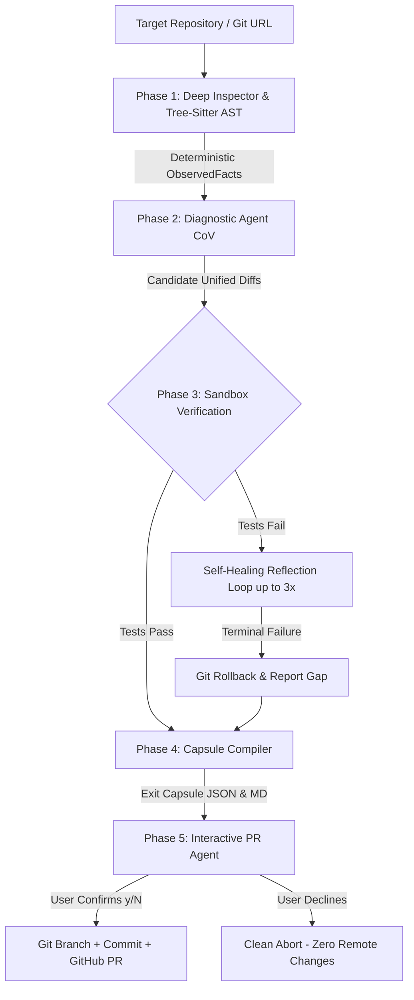

# Universal Maintenance Agent (UMA)

> **Enterprise-Grade Autonomous Multi-Agent Maintenance System**  
> Agent Skills Open Standard v1.0.0 · Track 2 · Hacktoberfest 2026

[](https://www.python.org/)
[](https://fastapi.tiangolo.com/)
[](https://react.dev/)
[](https://aistudio.google.com/)
[](LICENSE)

---

## 🌟 What It Does

The **Universal Maintenance Agent (UMA)** autonomously audits any software repository and produces a **Dependency Exit Capsule** — a verified, schema-validated JSON + Markdown report separating:

| Label | Meaning |
|---|---|
| 🟢 **EXECUTED** | Empirically proven by running actual test suites in a sandbox |
| 🔵 **OBSERVED FACT** | Deterministically extracted from manifests/AST (zero LLM) |
| 🟡 **AI ADVISORY** | Proposed by Gemini/Groq via Chain-of-Verification reasoning |
| ⬜ **UNVERIFIED** | Sandbox was skipped — treat as advisory only |

Works on **Python, Node.js, Go, Rust, Java** and any Git-hosted repository.

---

## 🏗️ Multi-Agent Architecture



| Phase | Agent | Role |
|---|---|---|
| **1** | `DeepInspectorAgent` + `TreeSitterInspector` | Static analysis, manifest parsing, AST import/error extraction — **zero LLM** |
| **2** | `DiagnosticAgent` | Gemini 2.5 Flash / Groq / Ollama with Chain-of-Verification reasoning |
| **3** | `SandboxAgent` | Applies patches, runs `pytest`/`npm test`/`cargo test`, self-heals up to 3× |
| **4** | `CapsuleCompiler` | JSON Schema validation + Jinja2 Markdown report |
| **5** | `InteractivePRAgent` | `[y/N]` gate → Git branch + commit + GitHub PR |

---

## 📋 Prerequisites

| Requirement | Version | Notes |
|---|---|---|
| **Python** | 3.10+ | `python --version` |
| **Node.js** | 18+ | `node --version` — for the web frontend |
| **npm** | 9+ | `npm --version` |
| **Git** | any | Must be in PATH |
| **Gemini API Key** | — | Free at [aistudio.google.com](https://aistudio.google.com/app/apikey) |
| **GitHub Token** | — | Optional — only for Phase 5 PR creation |

---

## ⚡ Quick Setup (Recommended — One-Command Start)

### Step 1 — Clone the repository

```powershell
git clone https://github.com/your-username/universal-maintenance-agent.git
cd universal-maintenance-agent
```

### Step 2 — Create & activate a Python virtual environment

```powershell
# Create the venv
python -m venv .venv

# Activate (Windows PowerShell)
.venv\Scripts\Activate.ps1

# Activate (Windows CMD)
.venv\Scripts\activate.bat

# Activate (Linux / macOS)
source .venv/bin/activate
```

> **Tip:** You should see `(.venv)` in your prompt after activation.

### Step 3 — Install Python dependencies

```powershell
pip install -r requirements.txt
```

### Step 4 — Configure environment variables

```powershell
# Copy the template
copy .env.example .env        # Windows
cp .env.example .env          # Linux / macOS
```

Now open `.env` and fill in your keys:

```ini
# ── REQUIRED ──────────────────────────────────────────────────────────────────
# Google Gemini API key (free tier is sufficient)
# Get it from: https://aistudio.google.com/app/apikey
GEMINI_API_KEY=AIzaSy_YOUR_KEY_HERE

# Model to use (do not change unless you have quota for a larger model)
GEMINI_MODEL=gemini-2.5-flash

# ── OPTIONAL: Groq (faster open-weight fallback) ──────────────────────────────
# Get it from: https://console.groq.com/keys
GROQ_API_KEY=gsk_YOUR_KEY_HERE
GROQ_MODEL=llama-3.1-70b-versatile

# ── OPTIONAL: Local Ollama ─────────────────────────────────────────────────────
# First run: ollama serve && ollama pull llama3:8b
OLLAMA_BASE_URL=http://localhost:11434
OLLAMA_MODEL=llama3:8b

# ── OPTIONAL: GitHub PR Agent (Phase 5 only) ──────────────────────────────────
# Create a PAT at: https://github.com/settings/tokens
# Required scopes: repo (full)
GITHUB_TOKEN=ghp_YOUR_TOKEN_HERE

# ── General ───────────────────────────────────────────────────────────────────
DEBUG=0
```

### Step 5 — Install frontend dependencies

```powershell
cd frontend
npm install
cd ..
```

---

## 🚀 Running the Project

### Option A — One-Click Start (PowerShell)

Starts **both** the FastAPI backend and Vite frontend simultaneously and opens your browser:

```powershell
.\start.ps1
```

- **Backend API:** http://localhost:8000
- **Frontend UI:** http://localhost:5173

---

### Option B — Manual (Two Terminals)

**Terminal 1 — Python Backend (FastAPI)**

```powershell
# Make sure your .venv is active first!
.venv\Scripts\Activate.ps1

cd backend
python -m uvicorn main:app --reload --port 8000
```

Expected output:
```
INFO:     Uvicorn running on http://127.0.0.1:8000
INFO:     Application startup complete.
```

**Terminal 2 — React Frontend (Vite)**

```powershell
cd frontend
npm run dev
```

Expected output:
```
  VITE v8.x ready in 457ms
  ➜  Local:   http://localhost:5173/
```

Open **http://localhost:5173** in your browser.

---

### Option C — CLI Only (No Frontend)

Run the agent directly from the command line without starting the web UI:

```powershell
# Activate your venv first
.venv\Scripts\Activate.ps1

# Basic audit on a remote GitHub repository
python main.py --repo https://github.com/rishrek/LinkWatch

# Fast read-only audit (skips sandbox, skips PR prompt)
python main.py --repo https://github.com/rishrek/LinkWatch --skip-sandbox --no-pr

# Audit a local directory
python main.py --repo C:\path\to\your\project

# Auto-confirm PR creation (for CI/CD pipelines)
python main.py --repo https://github.com/rishrek/LinkWatch --auto-pr

# Custom output directory
python main.py --repo https://github.com/rishrek/LinkWatch --output ./my_audit
```

### CLI Flags Reference

| Flag | Description | Default |
|---|---|---|
| `--repo` / `-r` | **(Required)** GitHub URL or local path | — |
| `--output` / `-o` | Directory to save capsule files | `./output` |
| `--skip-sandbox` | Skip patch application & test runs | `False` |
| `--no-pr` | Disable interactive PR creation prompt | `False` |
| `--auto-pr` | Auto-confirm PR without `[y/N]` prompt | `False` |
| `--json-only` | Write only JSON, skip Markdown report | `False` |

---

## 🖥️ Using the Web UI

1. Open **http://localhost:5173**
2. Paste any GitHub repository URL (e.g. `https://github.com/rishrek/LinkWatch`)
3. Choose your LLM provider (Gemini recommended)
4. Toggle **Skip Sandbox** on/off (on = fast read-only audit)
5. Click **Run Maintenance Audit**

The dashboard shows:
- **Live Agent Log** — real-time SSE stream from all 5 agents
- **Verdict Banner** — Verified / Partially Verified / Not Verified / Failed
- **Trust Meter** — breakdown of Executed vs Observed vs AI Advisory claims
- **Risks tab** — AST syntax errors (empirical) + AI risk indicators
- **Patches tab** — collapsible unified diffs with status badges
- **Tests tab** — sandbox execution results, stdout/stderr tails
- **Raw JSON tab** — full Dependency Exit Capsule for download

**Export options:**
- Download raw `dependency_exit_capsule.json`
- Open self-contained HTML report in a new tab
- Copy PR description to clipboard

---

## 🔑 API Keys — Where to Get Them

### Gemini API Key (Required)

1. Go to [https://aistudio.google.com/app/apikey](https://aistudio.google.com/app/apikey)
2. Sign in with your Google account
3. Click **Create API key**
4. Copy the key (starts with `AIzaSy...`)
5. Paste into `.env` as `GEMINI_API_KEY=AIzaSy...`

> ✅ The free tier is sufficient — 15 RPM / 1M tokens per day.

### Groq API Key (Optional)

1. Go to [https://console.groq.com/keys](https://console.groq.com/keys)
2. Create an account and generate a key (starts with `gsk_...`)
3. Paste into `.env` as `GROQ_API_KEY=gsk_...`

### GitHub Personal Access Token (Optional — Phase 5 only)

Only needed if you want the PR Agent to automatically open pull requests.

1. Go to [https://github.com/settings/tokens](https://github.com/settings/tokens)
2. Click **Generate new token (classic)**
3. Select scope: ✅ **repo** (full control)
4. Copy and paste into `.env` as `GITHUB_TOKEN=ghp_...`

---

## 📦 Output Artifacts

Every run saves two files to `output/` (or your `--output` directory):

```
output/
├── dependency_exit_capsule.json    ← Machine-readable, schema-validated
└── dependency_exit_capsule.md      ← Human-readable Markdown report
```

The JSON capsule has 10 standard fields:

```jsonc
{
  "maintenance_problem_identified": "...",          // Summary
  "relevant_dependency_or_repo_details": { ... },   // 🔵 OBSERVED FACT
  "risk_indicators": [ "..." ],                     // 🟡 AI ADVISORY
  "usage_locations": [ "file.py:42" ],              // 🔵 OBSERVED FACT (AST)
  "ai_generated_analysis_or_recommendations": "...",// 🟡 AI ADVISORY
  "proposed_changes_or_maintenance_approach": "...",// 🟡 AI ADVISORY (diffs)
  "suggested_tests_or_verification_steps": [ "..." ],
  "executed_test_results": {                        // 🟢 EXECUTED (empirical)
    "command": "pytest",
    "exit_code": 0,
    "success": true,
    "attempts": 1,
    ...
  },
  "compatibility_or_maintenance_gaps": [ "..." ],
  "unresolved_concerns_and_limitations": [ "..." ]
}
```

---

## 📂 Full Project Structure

```
newer_hacktober/
│
├── .env                                  ← Your private config (not committed)
├── .env.example                          ← Configuration template
├── .gitignore
├── requirements.txt                      ← Root Python deps (CLI usage)
├── main.py                               ← CLI entry point
├── start.ps1                             ← One-click start (backend + frontend)
├── README.md                             ← This file
│
├── backend/
│   ├── main.py                           ← FastAPI app (SSE, REST, HTML export)
│   └── requirements.txt                  ← Backend-specific Python deps
│
├── frontend/
│   ├── src/
│   │   ├── api/index.ts                  ← Typed API + SSE subscription hook
│   │   ├── components/
│   │   │   ├── Badge.tsx                 ← Provenance color badges
│   │   │   ├── AgentStepper.tsx          ← Live 5-phase pipeline stepper
│   │   │   ├── LogConsole.tsx            ← Auto-scroll SSE log stream
│   │   │   ├── VerdictBanner.tsx         ← Sticky 4-state trust verdict
│   │   │   ├── TrustMeter.tsx            ← Claim provenance bar chart
│   │   │   ├── PatchViewer.tsx           ← Collapsible unified diff viewer
│   │   │   ├── RiskList.tsx              ← AST errors + AI risk indicators
│   │   │   ├── TestMatrix.tsx            ← Sandbox execution result table
│   │   │   └── ExportBar.tsx             ← JSON / HTML / PR description export
│   │   ├── pages/
│   │   │   ├── Launch.tsx                ← GitHub URL input + live repo preview
│   │   │   └── RunDashboard.tsx          ← 5-tab results dashboard
│   │   ├── App.tsx
│   │   └── index.css                     ← Tailwind v4 + JetBrains Mono theme
│   ├── vite.config.ts                    ← Vite + Tailwind v4 + proxy to :8000
│   └── package.json
│
├── output/
│   ├── dependency_exit_capsule.json
│   └── dependency_exit_capsule.md
│
└── skills/
    └── universal-maintainer/
        ├── SKILL.md                      ← Agent Skills Open Standard metadata
        ├── agents/
        │   ├── inspector_agent.py        ← Phase 1: Deterministic inspector
        │   ├── tree_sitter_inspector.py  ← Phase 1: Multi-language AST parser
        │   ├── diagnostic_agent.py       ← Phase 2: CoV LLM diagnostic agent
        │   ├── sandbox_agent.py          ← Phase 3: Sandbox + self-healing
        │   ├── capsule_compiler.py       ← Phase 4: Schema validation + report
        │   └── pr_agent.py              ← Phase 5: Git branch + GitHub PR
        ├── prompts/
        │   ├── diagnostic_prompt.py      ← Chain-of-Verification prompt builder
        │   └── reflection_prompt.py      ← Self-healing reflection prompts
        └── references/
            └── exit_capsule_schema.json  ← JSON Schema specification
```

---

## 🛠️ Troubleshooting

### `ModuleNotFoundError` on startup
```powershell
# Make sure the venv is activated
.venv\Scripts\Activate.ps1
pip install -r requirements.txt
```

### `UnicodeEncodeError` on Windows
The CLI wraps stdout in UTF-8 automatically. If you still see this, run:
```powershell
$env:PYTHONIOENCODING = "utf-8"
python main.py --repo ...
```

### Gemini 503 / 429 (rate limit)
The `DiagnosticAgent` has automatic exponential backoff (up to 4 retries). If it still fails, wait 60 seconds and retry, or switch to Groq:
```ini
# In .env — comment out GEMINI_API_KEY to force Groq fallback
# GEMINI_API_KEY=...
GROQ_API_KEY=gsk_...
```

### Frontend can't reach backend (`Network Error`)
Ensure the backend is running on port 8000 **before** starting the frontend. The Vite dev server proxies `/runs` and `/health` to `localhost:8000`.

### Tree-Sitter language bindings missing
```powershell
pip install tree-sitter-python tree-sitter-javascript tree-sitter-typescript
```

### `git clone` fails (private repo or SSH)
Use a local path instead:
```powershell
python main.py --repo C:\Users\you\my-local-project
```

---

## 🔒 Security Notes

- **Never commit `.env`** — it is listed in `.gitignore` by default.
- Your `GITHUB_TOKEN` only needs `repo` scope. Do not use tokens with `admin:org` or `delete_repo` permissions.
- The sandbox agent never pushes to remote without explicit `[y/N]` user confirmation (or `--auto-pr` flag).

---

## 📜 Standards & License

This skill complies with the [Agent Skills Open Standard](https://agentskills.io) v1.0.0.  
Compatible with Antigravity, Claude Code, Cursor, and any CLI-based AI coding agent.

**License:** MIT
